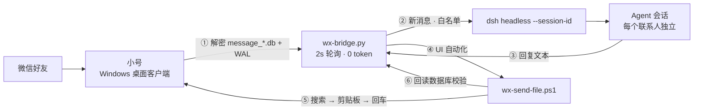

# 把 DeepSeek 接进微信：小号双向桥接完全指南

[](LICENSE)
[]()
[]()
[]()

> 用一台常开的 Windows + 一个微信**小号**，让 agent 真正读得到、回得了、还能主动发微信消息。
> 实测环境：微信 **4.1.9.57** / Windows 11 家庭版 / DeepSeek Harness 0.2.0 / Python 3.12 / **不需要管理员**。
>
> 这份文档的目标：**别人拿到仓库后，用最少的 token 复现整套流程**。所有逆向结论都写死了，不需要你的 agent 再猜。

**它能做什么**

- 📥 读：解密微信 4.x 的 SQLCipher 数据库，拿到全部聊天记录（含图片）
- 📤 写：模拟桌面客户端发消息，支持文字、文件、图片
- 🤖 回：新消息自动唤醒 agent，每个联系人独立会话
- 🛡️ 控：白名单、操作电脑需主人批准、发送后回读校验
- 🖥️ 管：常驻 + 心跳 + 锁屏/睡眠处理 + 图形控制台


---

## 0. 先说结论：什么时候值得折腾

| | 官方机器人通道（如 ClawBot） | 本方案（小号 + 桌面客户端） |
|---|---|---|
| 实时性 | 好（长轮询） | 好（2 秒轮询） |
| 主动发消息 | 只能发到绑定的那个会话 | ✅ 任意好友、任意时间 |
| 发文件/图片 | 支持 | ✅ 支持 |
| 读历史 | 只读机器人收到的 | ✅ 全量（含别人发的） |
| 限制 | **一个回复窗口 10 条** | 无 |
| 代价 | 无 | 要一台常开 Windows；UI 自动化会抢前台；锁版本 |

**建议**：只是做通知/问答，用官方机器人；要"像真人一样用微信"，再上本方案。

---

## 1. 架构



三条链路各自独立，可以分开调试：

1. **读**：解密数据库，拿到消息
2. **写**：模拟键盘鼠标，从桌面客户端发出
3. **唤醒**：把一条消息变成一个 agent turn

---

## 2. 准备清单

- 一台**常开、不睡眠**的 Windows 10/11（笔记本要插电）
- **微信 4.1.9.57** 安装包（4.1.10+ 拿不到密钥，见坑 1）
- 一个微信**小号**（建议专门注册，只加必要好友）
- Python 3.10+，装 `pycryptodome`、`zstandard`
- Node.js + 你的 agent CLI（本文用 DSH；**只要支持"向已有会话追加一条消息"** 就能替换）
- 30–60 分钟

> 小号登录会顶掉这台电脑上原来的微信登录，手机上不受影响。别在同一台机器上同时挂大号和小号。

---

## 3. 快速开始

> 每一步都有「验收」。失败先看第 6 节的坑，不要自己改加密参数。

### Step 0 锁版本（最重要）

确认微信版本 **≤ 4.1.9**（推荐 4.1.9.57）：

```powershell
(Get-Item "D:\wechat\Weixin\Weixin.exe").VersionInfo.FileVersion
```

同时**关掉自动更新**（设置 → 关于 → 自动更新）。4.1.10 起密钥不再以明文形式留在进程内存，前面所有工作作废。

### Step 1 登录小号 + 数据隔离

1. 退出旧版微信（如果装过别的版本）。
2. 把旧数据目录改名隔离，**不要删**：
   ```powershell
   Rename-Item "C:\Users\<你>\Documents\xwechat_files" "xwechat_files_old"
   ```
3. 安装 4.1.9.57，登录小号。**安装时不要勾「导入聊天记录」**。
4. 找数据目录：微信 → 设置 → 文件管理。默认形如
   `D:\wechat\xwechat_files\wxid_xxxx_1234\`。

验收：`db_storage\message\message_0.db` 存在，且是加密的（文件头不是 `SQLite format 3`）。

### Step 2 取数据库密钥

微信保持登录，运行（读进程内存，只读，不注入）：

```powershell
powershell -ExecutionPolicy Bypass -File tools\dump-keys.ps1 > tmp\keys.txt
```

输出每行 `salt:key`，19 个库 19 把钥匙。

验收：`tmp\keys.txt` 有十几行；第一行形如 `abcd1234...:deadbeef...`（salt:key）。

> 重登/换号后密钥会变。解不开任何库时，先重跑这一步。

### Step 3 读消息

```powershell
python tools\wx-read.py 20
```

验收：打印最近 20 条，形如 `10-18 23:33:05 [备注名] wxid_xxx: 内容`。

> 这一步跑通，说明 SQLCipher 参数、WAL 合并、zstd 解压、表名映射全部正确。
> 细节见 `docs/crypto.md`。

### Step 4 发消息（UI 自动化）

```powershell
powershell -ExecutionPolicy Bypass -File tools\wx-ui-send.ps1 -To "好友备注" -Text "你好"
```

验收：对方真的收到了。

**注意**：脚本打印「已发送给」**不代表发出去了**。桥接层必须回读数据库确认（见坑 23）。
这一步的难点全在窗口：托盘、前台锁、锁屏、睡眠，详见坑 19–22。

### Step 5 桥接主循环

1. 复制配置模板：
   ```powershell
   copy tools\wx-bridge-config.example.json tools\wx-bridge-config.json
   ```
2. 改里面四个值：`workspace`、`node`、`dshBin`，以及**你自己的 wxid**。
3. **「主人」（你自己）要单独建会话**，不要用 `--add-peer`（它建的是 guest 人格）：
   ```powershell
   node <你的 dshBin> headless --json "你是微信小号的回复助手。以后每条主人发来的消息，你只输出要回给 ta 的话：中文、简短口语、1-3 句、不要 Markdown。这条只是初始化，回复「好」即可。"
   ```
   输出里会有 `session-xxxxxxxx-...`，把它填进 `tools\wx-bridge-config.json` 的第一条：
   ```json
   { "wxid": "你的wxid", "name": "你的备注", "kind": "owner", "sessionId": "session-..." }
   ```
4. 加其他允许自动回复的好友（每个都会建独立会话）：
   ```powershell
   python tools\wx-bridge.py --list-contacts
   python tools\wx-bridge.py --add-peer "好友备注"
   ```
5. 自检一条（会真的发出去）：
   ```powershell
   python tools\wx-bridge.py --test "在吗"
   ```
6. 常驻：
   ```powershell
   powershell -ExecutionPolicy Bypass -File tools\wx-bridge-control.ps1
   ```

验收：日志 `tmp\bridge.log` 出现 `桥接启动`；给对方发一条微信，10–20 秒内收到回复。

关键设计：
- **每个联系人一个会话**，互不可见（否则会把 A 的隐私聊给 B）。
- 只有 `peers` 白名单里的人会被回复。
- 一条消息一个 `dsh headless` 进程；串行处理，不并发写同一会话。

### Step 6 图片

图片不需要额外运行，桥接会自动处理：

1. 消息里只记 `[图片:lid=N]`；
2. 用 `message_resource.db` 查这条消息对应的磁盘文件哈希；
3. 用 `wx_images.py` 把 V2 `.dat` 解成 jpg（AES-128-ECB + XOR）；
4. 把 jpg 路径塞进提示词，让模型用 `read_image` 看。

验收：发一张图，回复里能描述图片内容。

> 图片密钥**不要扫内存**。用公式：`aes = md5(str(uin) + wxid)[:16]`，`xor = uin & 0xFF`，
> `uin` 从 `%APPDATA%\Tencent\xwechat\net\kvcomm\key_<uin>_*.statistic` 的文件名里取。
> 换号重登后 uin 会变，重新取一次即可。细节见 `docs/crypto.md`。

### Step 7 稳定性（这一节决定能不能长期跑）

- **锁屏**：锁屏后模拟键鼠发不出去。桥接每轮检查 `LogonUI.exe`；无密码账户可以回车+点击解锁。
- **睡眠**：睡眠醒来会一次堆积很多旧消息。`staleSeconds`（默认 1800）会跳过超过 30 分钟的消息，避免刷屏。
- **卡死**：每条消息的处理放在子线程里，超时（`handleTimeout`，默认 300 秒）就跳过这一条并推进游标，否则整条桥接永久停摆。
- **心跳**：每 5 分钟写一行 `心跳 pid=… 微信=在线/未运行 屏幕=锁定/解锁`，并强制重扫一次，自动重试上一轮失败的消息。
- **显示器**：UI 自动化要求屏幕是亮的。`wx-send-file.ps1` 会先 `MonitorOn`，发完如果本来没人用就把屏幕关回去；`wx-blackscreen.py` 用纯黑窗口防止熄屏（可选）。

### Step 8 控制台与自启（可选）

- `tools\wx-bridge-ui.ps1`：一个 WinForms 小面板，状态灯 + 启动/停止/暂停/测试/日志/开机自启。
- 开机自启：把下面这行存成 `shell:startup` 下的 `.vbs`（无窗口）：
  ```vbs
  Set sh = CreateObject("WScript.Shell")
  sh.Run """<pythonw.exe>"" ""<repo>\tools\wx-bridge.py""", 0, False
  ```

---

## 4. 你需要改的常量

只有 4 类、共 8 个值（都在文件顶部，搜 `CHANGE_ME`）：

| 文件 | 常量 | 填什么 |
|---|---|---|
| `tools/wx-bridge.py` | `DB_DIR` | 小号数据目录下的 `db_storage` |
| `tools/wx-read.py` | `DB_DIR` | 同上 |
| `tools/wx_images.py` | `BASE` / `SELF_WXID` | 小号数据目录（去掉 `\db_storage`）/ 小号 wxid |
| `tools/wx-bridge-control.ps1`、`wx-bridge-ui.ps1`、`wx-send-file.ps1` | `CHANGE_ME_PYTHON_DIR` | 你的 Python 目录（含 `pythonw.exe`） |

其余全部在 `tools\wx-bridge-config.json` 里：联系人、会话、Node/DSH 路径。

---

## 5. 仓库结构

```
wechat-deepseek-bridge/
├─ README.md                     ← 本文
├─ docs/
│  ├─ crypto.md                  ← SQLCipher / WAL / .dat 逆向细节
│  └─ agent-playbook.md          ← 直接喂给 agent 的复现指令（省 token）
├─ tools/
│  ├─ dump-keys.ps1              ← 从内存取 DB 密钥
│  ├─ wx-read.py                 ← 解密 + 读消息
│  ├─ wx_images.py               ← V2 .dat 图片解密
│  ├─ wx-bridge.py               ← 主循环（监听→唤醒→代发→校验）
│  ├─ wx-ui-send.ps1             ← 搜索联系人 + 粘贴 + 回车
│  ├─ wx-send-file.ps1           ← 唤醒窗口 + 抢前台 + 发送
│  ├─ wx-bridge-control.ps1      ← 启停
│  ├─ wx-bridge-ui.ps1           ← 图形控制台
│  └─ wx-blackscreen.py          ← 防熄屏（可选）
├─ CONTRIBUTING.md
├─ SECURITY.md
├─ .github/
│  ├─ ISSUE_TEMPLATE/bug_report.yml
│  └─ PULL_REQUEST_TEMPLATE.md
├─ tools/wx-bridge-config.example.json
├─ LICENSE
└─ .gitignore
```

---

## 6. 踩坑清单

> 按出现顺序。每一条都是实际踩过的，不是理论。

### 版本与环境

1. **4.1.10+ 取不到密钥**。内存里不再保留 `x'<enc_key><salt>'`。必须锁 4.1.9.57，并关自动更新。
2. **降级别硬开旧库**。4.1.9 打开 4.1.15 的数据库有损坏风险。先把整个数据目录改名隔离，再装旧版。
3. **安装时别勾「导入聊天记录」**，否则会去碰旧数据。
4. **小号登录会顶掉本机原来的微信**。手机端不受影响，但同一台电脑只能挂一个号。
5. **同用户读内存不需要管理员**。`dump-keys.ps1` 以当前用户跑即可；只有读系统级进程才要提权。

### 编码

6. **含中文的 `.ps1` 必须存成 UTF-8 带 BOM**。否则 PowerShell 5.1 按 GBK 解析，直接语法错误。
7. **控制台中文乱码**：Python 端设 `PYTHONIOENCODING=utf-8`，PowerShell 端设 `[Console]::OutputEncoding=[Text.Encoding]::UTF8`。
8. **Python 调 PowerShell 传中文没问题**（参数走 UTF-16），但脚本内容编码要对，别用 `>` 重定向中文。

### 数据库

9. **SQLCipher 4 参数**：page 4096、reserve 80；第 1 页前 16 字节是 salt，解密后要手动补 `SQLite format 3\0`。
10. **每个库一把钥匙**。内存里是 `x'<64hex 派生密钥><32hex salt>'`，不是原始密码。
11. **密钥要用 HMAC 校验**，别用"能不能解出表头"判断：`mac_key = PBKDF2-SHA512(enc_key, salt XOR 0x3a, 2)`，`HMAC-SHA512(mac_key, page[16:4032] + uint32LE(1)) == page[4032:4096]`。
12. **WAL 必须合并**。新消息先写 `-wal`，主库滞后。
13. **WAL 是预分配的 4MB，size 永远不变**。检测变化用 `mtime`，不能用文件大小。
14. **WAL 帧要按 salt 过滤**（`frame[8:16] == wal_header[16:24]`），否则旧帧会把页面写坏。
15. **消息内容是压缩的**。`WCDB_CT_message_content == 4` 是 zstd，其余是 UTF-8 明文。
16. **表名是 `Msg_<md5(wxid)>`**，发送者用 `Name2Id` 映射，`create_time` 是秒级时间戳。
17. **微信独占数据库**。直接读会失败，要先复制/解密到临时文件；用 `FileShare.ReadWrite` 打开原始文件。
18. **重登后密钥变**。所有库突然解不开，先重跑 `dump-keys.ps1`。

### UI 自动化

19. **收进托盘后 `MainWindowHandle = 0`**。`Get-Process` 找不到窗口，必须 `EnumWindows` 枚举隐藏窗口：class `Qt51514QWindowIcon`、标题不为空且不是 `Weixin`。
20. **前台锁**。后台进程 `SetForegroundWindow` 会被系统拒绝；要 `AttachThreadInput` + 循环重试 + 每次校验 `GetForegroundWindow() == 目标`。
21. **屏幕关闭时前台化失败**。先发 `WM_SYSCOMMAND / SC_MONITORPOWER -1` 点亮屏幕，再抢前台。
22. **锁屏时模拟键鼠无效**。用 `tasklist` 探 `LogonUI.exe`；无密码账户可以回车 + 点一下解锁（有密码的没法自动）。
23. **「已发送」不可信**。脚本没报错 ≠ 发出去。必须回读数据库，确认该会话多了一条自己的消息；没有就重试（最多 3 轮）。
24. **中文不能 SendKeys**。一律走剪贴板：`Set-Clipboard` → `Ctrl+V` → `Enter`。
25. **搜索联系人有歧义**。`Ctrl+F` + 粘贴备注名 + 回车；同名联系人会选错，备注要唯一。
26. **发送会抢前台**。用户正在操作时会看到窗口跳一下，这是方案本身的代价，接受不了就改用官方机器人。

### 桥接与唤醒

27. **`dsh headless --session-id` 是最好用的唤醒方式**：2–3 秒启动、能接续历史、无需改宿主。
28. **不要并发写同一个会话**。一条一条串行处理；GUI 和后台同时写同一个会话会有同步问题。
29. **每个联系人独立会话**。共用会话会把 A 的聊天记录带给 B。
30. **白名单**。只回 `peers` 里的人，陌生人不自动开口。
31. **卡死保护**。模型调用可能卡住；用子线程 + 超时（默认 300 秒），超时就跳过这条并推进游标。
32. **睡眠后别补回旧消息**。醒来时可能堆积几十条；超过 30 分钟的直接跳过，否则会刷屏且浪费 token。
33. **上下文会一直涨**。会话历史越长，每条消息越贵；几百条后换一个新会话（改 `sessionId`）即可。
34. **定时轮询太贵**。5 分钟一次 ≈ 150–230 万 token/天；事件驱动只在真有消息时花 token。

### 图片

35. **微信 4.x 图片是 V2 `.dat`**：`[6B magic 07 08 56 32 08 07][4B aes_size LE][4B xor_size LE][1B pad]` + `[AES-128-ECB][raw][XOR]`。
36. **AES 段对齐**：`aes_size % 16 == 0` 时要再加 16（PKCS7 整块 padding）。
37. **密钥不是扫内存**。`aes = md5(str(uin) + wxid)[:16]`，`xor = uin & 0xFF`；`uin` 从 kvcomm 文件名取。
38. **XML 里的 `md5` ≠ 磁盘文件名**。文件名的哈希在 `message_resource.db` 的 `packed_info` 里（`\x12\x22\x0a\x20` 后 32 字节 ASCII hex）。
39. **消息先入库、资源和文件后到**。图片要重试（6 次 × 2 秒），否则第一次必然失败。
40. **弱 magic 会选出假钥匙**。2 字节的 `BM` 别用；校验整份文件尾（JPEG `FF D9` / PNG `IEND`）。
41. **模型要支持视觉**，并且有 `read_image` 工具；否则只能退化成 OCR/描述占位符。

### 其它

42. **语音是 SILK**，4.x 还要转码，建议第一版不做。
43. **机器人通道一个窗口最多 10 条**，小号这条线没有这个限制。
44. **开源前清个人信息**：wxid、uin、本机路径、会话 id、联系人备注、`tmp/keys.txt`、解密的 db。
45. **合规**：只处理自己的账号；不要拿去做群发/营销；密钥等同于账号密码。

---

## 7. 成本

- 空转：0 token（本地轮询）。
- 每条微信消息：一个 agent turn。以一个 10–15k token 的会话为例，一条消息大约几千 token；一天几十条消息，成本是可接受的。
- 图片：多一次 `read_image` 的视觉 token。
- 对照：定时轮询 5 分钟一次，一天 288 个 turn，约 150–230 万 token/天（还全是空转）。

---

## 8. 安全与合规

- `tmp/keys.txt`、`tmp/*.db`、`tmp/wx-images/` 都是明文，**不要提交**（仓库里已给 `.gitignore`）。
- 小号只加必要好友；桥接有白名单，默认不回复陌生人。
- 好友要求"操作电脑"时，建议加一道**请示闸门**：guest 会话第一行输出 `[请示] …`，桥接把请求转给主人，主人回「同意」才执行。本仓库的 `wx-bridge.py` 已内置。
- 不要把 `keys.txt` 发给任何人，包括"帮你调试"的人。

---

## 9. 排错速查

| 现象 | 先查 |
|---|---|
| `没有这个库的密钥` | 重跑 dump-keys；确认微信在跑 |
| 解出来是乱码/表不存在 | 版本 >4.1.9，或 WAL 盐没过滤 |
| 发消息后对方没收到 | 窗口是否托盘/锁屏/最小化；回读数据库；看 `bridge.log` |
| 回复是「图片没解出来」 | `.dat` 还没落盘（重试）；`message_resource` 行缺失 |
| `图片：本地解密失败` 一直 | 图片密钥/uin 变了；重跑 `wx_images.py --key` |
| 桥接启动但没反应 | 联系人不在 `peers`；游标已推进；暂停标记 `tmp/bridge.pause` |
| 发送超时 | 前台锁；屏幕关了；微信被别的窗口挡住 |
| 睡眠后不回消息 | `staleSeconds` 跳过了旧消息；看日志 `跳过过期消息` |

---

## 10. 给 agent 的复现提示词（直接复制）

```
你在 Windows 上复现一个「微信小号 ↔ agent」桥接。仓库里已有全部脚本和文档。

规则：
1. 先读 README §2–§3，按 Step 0→8 顺序执行，每一步跑「验收」。
2. 只有 4 类 CHANGE_ME 需要替换（README §4）；不要改写加密参数、WAL 逻辑、UI 自动化流程。
3. 遇到错误先查 README §6 的坑，按编号定位；不要自己发明解密方式。
4. 图片密钥用公式推导（uin + wxid），不要扫内存。
5. 验证发送是否成功必须回读数据库，不要相信脚本的「已发送」。
6. 成本控制：用 --test 单条验证；不要把整段历史喂给模型；不要用定时轮询。
7. 每完成一步，把验收结果和下一步命令告诉我，不要一次性跑完所有步骤。
```

---

## 11. 致谢与来源

- SQLCipher 4 参数、HMAC 校验、WAL 盐过滤：从微信 4.x 客户端行为逆向，并与公开的 wechat-dump 类项目交叉验证。
- V2 图片格式与 `uin + wxid` 派生：参考 [wechat-decrypt](https://github.com/Bryan-Cyf/WeChatDaily) 及其引用的社区结论。
- 唤醒方式：DeepSeek Harness 的 `headless --session-id`。

仅用于学习与个人自动化。请遵守微信用户协议与当地法律；不要用于批量营销、骚扰或未经授权的数据访问。
